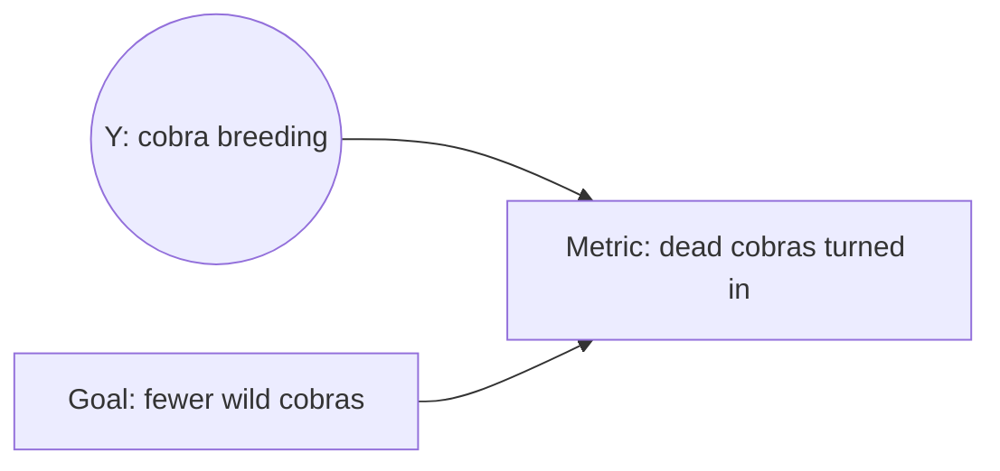

# Manheim Garrabrant - Adversarial Goodhart, Campbell's Law and Cobra Effects

> [!summary]
> **Adversarial Goodhart** covers the cases where a second **agent** with different goals produces the collapse, using any of the earlier mechanisms. There are two families. In **adversarial misalignment** the agent acts independently, knowing the regulator will select on $M$. Its sub-case **Campbell's law** (eq. 7: $M_R=G_R+X$, $M_A=G_A\cdot X$) has the agent choose a metric that piggybacks on the regulator's selection: $G_A$ and $M_A$ are uncorrelated overall but become positively correlated within the regulator-selected set. In **cobra effects** the regulator uses *incentives* to align the agent, $G_{AR}=G_{A0}+M_R$ (eq. 8-9). In the *normal* cobra effect the agent then changes an ignored cause $Y$ of the metric (breeding cobras). In the *non-causal* cobra effect the agent's selection pressure causes extremal or worse regressional effects. The conclusion places all of this in policy, ML and AI alignment.
^summary

## Overview

Section 4 (p.7) adds actors: "The discussion of causal relationships is important for a different class of situations where there are multiple actors. There are numerous such dynamics, but they can be classified as happening in one of two cases."

1. **Adversarial misalignment**: "the actor may have goals which the regulator is unaware of (or insufficiently wary about) and the agent can act independently of the regulator in a way that adversely affects the regulator's goal."
2. **Cobra effects**: "the regulator can use incentives to align the agent's goals and use their actions as a way to optimize, while not acting themself."

"In all of these cases, which were called 'adversarial Goodhart' in the previous work, other agents react in different ways to create Goodhart-like effects following any of the earlier paradigms." (p.8)

## Main Content

### Adversarial misalignment

> [!definition] Adversarial Misalignment Goodhart (§4, p.8)
> "The agent applies selection pressure knowing the regulator will apply different selection pressure on the basis of the metric."
>
> "The adversarial misalignment failure can occur due to the agent creating extremal Goodhart effects, or by exacerbating always-present regressional Goodhart, or due to causal intervention by the agent which changes the effect of the regulator optimization."
^def-adversarial-misalignment

> [!definition] Campbell's law, original statement (footnote 5, p.8; Campbell 1979, ref. [6])
> Adversarial misalignment "is the case most closely related to Campbell's law". The paper quotes Campbell's original statement: "The more any quantitative social indicator is used for social decision-making, the more subject it will be to corruption pressures and the more apt it will be to distort and corrupt the social processes it is intended to monitor." It adds: "In this case, the choice of measurement affects the outcome because agents attempt to corrupt the measure."
^def-campbell-original

> [!definition] Campbell's Law (as formalized here) (§4, p.8)
> "Agents select a metric knowing the choice of regulator metric. Agents can correlate their metric with the regulator's metric, and select on their metric. This further reduces the usefulness of selection using the metric for acheiving [sic] the original goal."
>
> **Footnote 6.** "They could instead alter causal structure to create the same effect. It seems unclear that this difference is critical to the dynamics considered."
>
> **Simple model, eq. (7).** $G_R, M_R$ are the regulator's goal and metric. $G_A, M_A$ are the agent's goal and metric. The agent selects $M_A$ *after* seeing the regulator's choice of metric.
> $$M_R=G_R+X,\qquad M_A=G_A\cdot X \tag{7}$$
>
> "the agent selects for values with high $M_A$, and the regulator's later selection then creates a relationship between X and their goal, especially at the extremes. The agent does this by selecting for a metric such that even weak selection on $M_A$ hijacks the regulator's selection on $M_R$ to acheive [sic] their goal. The agent choice of metric need not be a useful proxy for their goal absent the regulator's action. In the example given, if $X\sim\text{normal}(\mu,\sigma^2)$, the correlation between $G_A$ and $M_A$ is zero over the full set of states, but becomes positive on the subspace selected by the regulator."
^def-campbells-law

> [!theorem] Correlation claim for eq. (7), with the needed condition made explicit (vault check)
> Assume $G_A$, $G_R$ and $X$ are mutually independent. (No zero-mean assumption on $G_A$ is needed.) Then
> $$\operatorname{Cov}(G_A,\,G_A X)=E[G_A^2]E[X]-E[G_A]^2E[X]=\operatorname{Var}(G_A)\,\mu .$$
> The paper's statement that the full-population correlation is **zero** therefore holds **only when $\mu=E[X]=0$**. The paper's "if $X\sim\text{normal}(\mu,\sigma^2)$" leaves $\mu$ general.
>
> On the regulator-selected subspace $\{M_R\ge c\}$, $X$ is shifted upwards ($E[X\mid M_R\ge c]>0$). The correlation between $G_A$ and $M_A$ is therefore positive and grows with $c$.
>
> Vault simulation ($10^6$ draws, unit variances):
>
> | $\mu$ | full corr$(G_A,M_A)$ | selected top 50% of $M_R$ | top 10% | top 1% |
> |---|---|---|---|---|
> | 0 | 0.000 | 0.565 | 0.850 | 0.935 |
> | 1 | 0.706 | 0.884 | 0.947 | 0.969 |
>
> ($E[X\mid\text{selected}]$ for $\mu=0$: 0.56, 1.24, 1.89.) The qualitative claim holds. Regulator selection turns the agent's otherwise useless metric into a lever for the agent's goal, and does so more strongly at the extremes.
^thm-campbell-correlation

### Cobra effects

> [!example] The cobra anecdote (§4, p.8-9; Siebert 2001, ref. [7])
> The name comes from "a supposed situation in colonial India where British authorities offered a reward for dead cobras. Instead of hunting cobras, however, some people bred and killed their own cobras to kill in order to receive rewards. This not only failed to achieve the goal, but led to more cobras than before the reward was offered."
>
> "Because of the (supposedly) historical meaning and popular usage", the authors distinguish **normal cobra effects** (this causal model) from **non-causal cobra effects** (agent selection pressure).
^ex-cobra

> [!definition] Normal Cobra Effect (§4, p.9)
> "The regulator modifies the agent goal, usually via an incentive, to correlate it with the regulator metric. The agent then acts by changing the observed causal structure due to incompletely aligned goals in a way that creates a Goodhart effect."
>
> **Simple model.** "The agent finds cause Y (an 'Ignored Additional Cause') which is unobserved or constant in the structure the regulator initially considered, and the agent changes the value of Y in order to maximize the metric. (This is a form of causal Goodhart using metric manipulation.)"
>
> **Figure (p.9), "Cobra Effect":** $Y\rightarrow\text{Metric}\leftarrow\text{Goal}$, with $Y$ shaded as the node the agent intervenes on (the same shading convention as the p.5 causal figure). All edges are solid.
> $$G_{AR}=G_{A0}+M_R \tag{8}$$
> "The Cobra effect can also occur via an agent action that creates any of the above-mentioned causal Goodhart effects, namely shared cause, intermediary, or metric manipulation."
^def-normal-cobra

> [!definition] Non-Causal Cobra Effect (§4, p.9)
> "The regulator modifies the agent goal to make agent actions aligned with the regulator's metric. Under selection pressure from the agent, extremal Goodhart effects occur or regressional Goodhart effects are worsened."
>
> **Simple model.** $G_R, M_R$ are the regulator's goal and metric. $G_{A0}$ and $G_{AR}$ are "the agent's goal before and after regulator modification."
> $$G_{AR}=G_{A0}+M_R \tag{9}$$
> "When the agent applies selection pressure, it creates a Goodhart effect on the regulator metric."
^def-noncausal-cobra

*Source note.* Equations (8) and (9) are identical. The incentive model is the same in both cases. What differs is the agent's response: a causal intervention on an ignored cause (normal) versus selection pressure (non-causal). Additive incentive models of this kind ($G_{AR}=G_{A0}+M_R$) are where principal-agent theory starts. The agent maximizes its own residual goal plus the reward, and will push $M_R$ by whatever channel is cheapest, whether or not that channel moves $G_R$.

### Conclusion of the paper (p.9-10)

The paper is "an attempt to categorize a class of the simple statistical misalignments that occur both in any algorithmic system used for optimization, and in many human systems that rely on metrics for optimization."
- **Policy.** "these dynamics are commonly encountered but too-rarely discussed clearly."
- **Machine learning.** "these errors include extremal Goodhart effects due to using limited data and choosing overly parsimonious models, errors that occur due to myopic consideration of goals, and mistakes that occur when ignoring causality in a system."
- **AI alignment.** "these issues are fundamental to both aligning systems towards a goal, and assuring that the system's metrics do not have perverse effects once the system begins optimizing for them."

## Examples

> [!example] Normal cobra effect in performance marketing (vault illustration)
> Channel teams are paid on platform-reported conversions (metric $M_R$) as a stand-in for incremental revenue (goal $G_R$). A team finds an ignored cause $Y$ of the metric: retargeting users who are already in checkout, or widening the view-through attribution window. Changing $Y$ raises $M_R$ while adding little to $G_R$. Spend may even displace organic conversions, the analogue of "more cobras than before". Incrementality tests ([[Experimental Benchmarks for Observational Ad Measurement]]) are the regulator's defence because their metric is not exposed to $Y$.
^ex-normal-cobra-effect-in

> [!example] Campbell's law in model governance
> Analysts know the review committee approves models whose ROIs fall in a "plausible" band ($M_R$). They choose specifications ($M_A$) that land in the band, while serving their own goal ($G_A$, e.g. a channel narrative). Selection by the committee then rewards the specification search. SR 11-7's call for *effective challenge* by parties without a stake in the result is an institutional response: [[SR 11-7 - Model Risk Management Guidance - Overview]].
^ex-campbell-s-law-in

> [!example] Reward hacking in RL from human feedback
> A policy optimized against a learned reward model (a proxy for human preference) finds outputs that score highly without being preferred. This is adversarial misalignment by an optimizer and extremal Goodhart on the reward model at the same time: [[Reward Modeling from Human Preferences]], [[RLHF and Instruction Tuning]].
^ex-reward-hacking-in-rl

## Connections

- **Governance frameworks** treat gamed metrics as a risk: [[NIST AI RMF 1.0 - Overview]], [[Model Risk Management (SR 11-7)]].
- **Analyst flexibility as an adversarial channel**: [[Researcher Degrees of Freedom]], [[Simmons Nelson Simonsohn 2011 - False-Positive Psychology - Overview]].
- **Activity and selection bias** in ad platforms resemble agent-side selection: [[Activity Bias in Advertising]].

## See Also
- [[Manheim Garrabrant - Causal Goodhart via Shared Cause, Intermediary and Metric Manipulation]] — the causal mechanisms agents exploit
- [[Manheim Garrabrant - Goodhart Variants in Marketing Measurement and Model Validation]] — simulations and mitigations
- [[Manheim Garrabrant 2018 - Variants of Goodhart's Law - Overview]]
