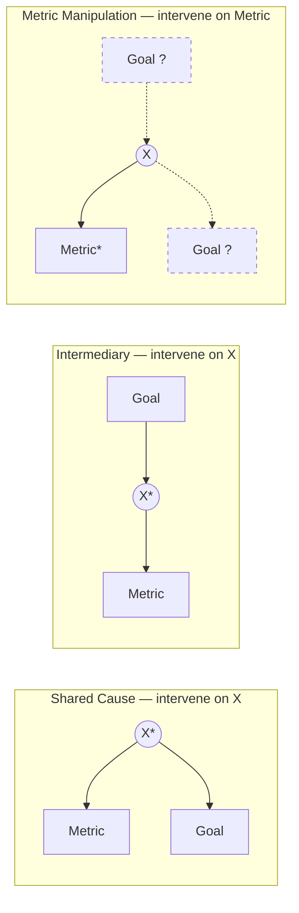

# Manheim Garrabrant - Causal Goodhart via Shared Cause, Intermediary and Metric Manipulation

> [!summary]
> **Causal Goodhart**: the regulator *intervenes* to raise the metric, and the intervention itself changes the causal pathway, so the proxy stops tracking the goal. Unlike regressional and extremal Goodhart, this needs no uncertainty and no mistaken beliefs about the observational relationship. Three cases are drawn as DAGs. **Shared cause** $M\leftarrow X\rightarrow G$: fixing $X$ leaves only residual noise linking $M$ and $G$. **Intermediary** $G\rightarrow X\rightarrow M$: setting $X$ makes $M\perp G$ and may not move $G$ at all. **Metric manipulation**: setting $M$ directly leaves the goal untouched. In a predictive model this is the classic mistake of using an associational driver (a SHAP value, an importance score, a regression coefficient) as a lever.
^summary

## Overview

The regressional and extremal cases rest on correlational structure: they "exist regardless of causal structure" (p.4). Causal Goodhart arises when "the regulator's actions themselves change the relationships". The paper notes that these "take the form of Goodhart-like problems, but can be better discussed in terms of the effect of regulator actions on the causal structure."

In do-calculus terms (vault framing; the paper uses no do-notation), the proxy-goal relationship that matters for optimization is $E[G\mid do(\cdot)]$, not $E[G\mid M]$. When the regulator intervenes on a node, the observational dependence of $G$ on $M$ that motivated the proxy no longer applies.

## Main Content

> [!definition] Causal Goodhart (§3, p.4)
> "When the causal path between the proxy and the goal is indirect, intervening can change the relationship between the measure and proxy. If a regulator intervenes to maximize a metric, the causal pathway can change such that the proxy no longer tracks the goal. In such cases, extreme interventions can be less effective than more moderate ones, and further selection or intervention can be counterproductive."
^def-causal

> [!theorem] Claim: causal Goodhart requires neither uncertainty nor error (§3, p.4)
> "Interestingly, this does not require any uncertainty, nor does it require an incorrect understanding of the relationships, unlike earlier cases. Instead, the effect is induced by the regulator's action."
^thm-causal-no-uncertainty

> [!example] Windmills (§3, p.4)
> "a regulator attempting to use a windspeed model to build windmills must be careful not to ignore the effect the windmills themselves have on wind-speeds. Building many windmills in a given area can alter the wind-speed in the region enough to invalidate the earlier relationship."
>
> The siting model can be perfectly correct about wind *before* intervention. Acting on it at scale changes the system it describes.
^ex-windmills

### The three causal Goodhart effects (figure, p.5)

The paper opens this subsection (p.4): "There are a three [sic] general cases which lead to causal Goodhart, as well as several others that may appear similar, but are actually regressional or extremal Goodhart effects." The look-alikes are covered in [[Manheim Garrabrant - Non-Causal Goodhart Effects in Causal Systems]].

In each panel the regulator acts on an observed correlation between Metric and Goal by intervening on the shaded node. Reconstructed from the figure:

(* = intervened node, which the paper shades grey. Edges in this figure are drawn solid in the paper.)

**How to read the Metric Manipulation panel (p.5).** The paper draws **Goal twice, both times as a dashed-outline node**. One copy sits *above* $X$ ($\text{Goal}\to X\to\text{Metric}$, so $X$ is an intermediary). The other sits *beside* Metric as a second child of $X$ ($\text{Metric}\leftarrow X\rightarrow\text{Goal}$, so $X$ is a shared cause). The two dashed Goals are **alternative placements, not two goals**. The definition's parenthetical refers to this double placement: "(In this case, it does not matter how the goal was related to X, as indicated in the figure.)" (p.5). Setting Metric directly cuts every incoming edge to Metric. Whether Goal reaches Metric through a chain or through a shared cause, the intervention severs the Metric-Goal link in the same way. In the mermaid sketch above, dashed edges and dashed node outlines mark these alternative positions. They are not an assumed/true distinction; that convention belongs to the p.6 figure in [[Manheim Garrabrant - Non-Causal Goodhart Effects in Causal Systems]].

> [!definition] Shared Cause Intervention (§3, p.5)
> "The regulator intervenes on a shared cause of the metric and the goal."
>
> **Simple model.** "The regulator sets the shared cause X to a maximal value. The Metric no longer has a causal relationship to the Goal. The relationship between Metric and Goal now consists entirely of the combination of the error terms between each and X."
>
> **Consequences (p.5).** It "may restrict both the Goal and the Metric to a region favored by the regulator, at the cost of changing the metric's relationship to the goal in a way that may be counterproductive for further optimization." It "does not imply that the overall outcome is worse than without the optimization, but more extreme interventions can be less effective than less extreme ones. For this reason, further selection or intervention on the basis of the metric can be counterproductive."
^def-shared-cause-intervention

> [!example] Two correlated tests (§3, p.5)
> Two tests given to students are correlated, partly because general test-taking skill affects both. A teacher who trains test-taking skills in general sets this shared cause, so "the remaining relationship between scores on the two tests is due to other factors, and the new correlation between scores is likely to be lower than the earlier correlation." Using one test to predict the other, or to select students, becomes less informative after the intervention.
^ex-two-tests

> [!definition] Intermediary Intervention (§3, p.5)
> "The regulator intervenes on a variable in the causal chain connecting Goal to Metric."
>
> **Simple model.** "The regulator sets X to a specific value. The relationship between the Goal and Metric now no longer exists; they are independent variables. This does not necessarily affect the Goal at all, but can serve to increase the value of the metric."
^def-intermediary-intervention

> [!definition] Metric Manipulation (§3, p.5-6)
> "The regulator intervenes to set the Metric, without affecting other nodes. (In this case, it does not matter how the goal was related to X, as indicated in the figure.)"
>
> **Simple model.** "The regulator sets M to a specific value. The relationship between Metric and Goal now no longer holds."
>
> **Example (p.6).** "a teacher changes test scores or grades. This doesn't contribute to the goal of learning, it simply changes M so that it is useless (or, if only some scores are changed, less useful) in measuring G."
>
> **Footnote 4.** "This is assuming the teacher is the regulator - if the teacher is an agent, this is a different case, explored below." If the teacher is an agent, the case becomes adversarial: [[Manheim Garrabrant - Adversarial Goodhart, Campbell's Law and Cobra Effects]].
^def-metric-manipulation

### Formal reading of the three cases (vault addition)

Take a linear-Gaussian SCM with independent noise terms $u_\cdot$.

| Case | Pre-intervention SCM | Intervention | Post-intervention $\operatorname{Cov}(M,G)$ | Effect on $G$ |
|---|---|---|---|---|
| Shared cause | $X=u_X$, $M=X+u_M$, $G=X+u_G$ | $do(X=x^*)$ | $\operatorname{Cov}(u_M,u_G)=0$ | $E[G]=x^*$: the goal *can* move, but $M$ no longer ranks states by $G$ |
| Intermediary | $G=u_G$, $X=G+u_X$, $M=X+u_M$ | $do(X=x^*)$ | $0$ | none |
| Metric manipulation | as above | $do(M=m^*)$ | $0$ | none |

In the vault simulation with unit variances, the shared-cause correlation drops from 0.50 before intervention to 0.00 after $do(X=3)$, while $E[G]$ rises to 3 ([[Manheim Garrabrant - Goodhart Variants in Marketing Measurement and Model Validation#^sim-causal]]). This matches the paper's point: the intervention may help the goal, but the metric is no longer useful for further optimization.

### Where causal Goodhart comes from (p.6)

- "The reason for causal Goodhart effects can either be due to mistaken or missing understanding of causal effects, or simple lack of foresight."
- "As with extremal Goodhart effects, mistakes about the causal connection can be due to insufficient data, or a change in regime."
- "Importantly, the same mistakes can also lead to extremal or (worsened) correlational Goodhart effects if there is selection instead of intervention." This is developed in [[Manheim Garrabrant - Non-Causal Goodhart Effects in Causal Systems]].

## Examples

> [!example] Acting on a predictive driver (vault illustration)
> A tree model predicts weekly sales. Branded search clicks get the largest SHAP value. Branded search is largely an *intermediary*: TV and offline demand → branded search → sales tracking. Raising branded-search bids increases the metric (attributed search conversions) without moving underlying demand much. This is intermediary intervention, and the observed metric-goal relationship falls apart. [[Blake Nosko Tadelis 2015 - Paid Search Effectiveness - Overview]] documents this pattern experimentally, and [[SHAP and Causal Interpretation of Predictive Models]] explains why SHAP cannot tell the cases apart.
^ex-acting-on-a-predictive

> [!example] Shared-cause intervention in promotions
> Seasonality drives both promotional depth (the metric a team watches) and sales (the goal). A regulator who "fixes" seasonality, for example by comparing only within peak weeks, removes the shared cause. Within peak weeks the promotion-sales correlation is much weaker than the full-year correlation suggested.
^ex-shared-cause-intervention-in

## Connections

- **Causal identification**: [[DAGs and Causal Identification]], [[Directed Acyclic Graphs]], [[Omitted Variables Bias]].
- **Interventional vs observational feature relevance**: the vault owner is [[Janzing et al 2020 - Feature Relevance as a Causal Problem - Overview]]. Practice guidance is in [[Dillon et al - SHAP and Causal Insights - Overview]].
- **Experiments as the cure**: randomized interventions estimate $E[G\mid do(\cdot)]$ directly: [[Experimental Benchmarks for Observational Ad Measurement]], [[The Experimental Ideal]].
- **Lucas critique** (footnote 1 of the paper): policy changes alter the reduced-form relationships estimated under the old policy. This is the macroeconomic analogue of the windmill example.

## See Also
- [[Manheim Garrabrant - Non-Causal Goodhart Effects in Causal Systems]] — causal *mistakes* under selection rather than intervention
- [[Manheim Garrabrant - Adversarial Goodhart, Campbell's Law and Cobra Effects]] — when an agent, not the regulator, performs the intervention
- [[Manheim Garrabrant 2018 - Variants of Goodhart's Law - Overview]]
