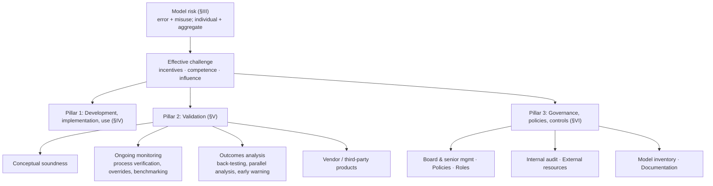

# SR 11-7 - Model Risk Management Guidance - Overview

> [!summary]
> SR 11-7 (April 4, 2011) is the joint Federal Reserve / OCC supervisory guidance that became the de facto standard for governing quantitative models. It defines a **model** broadly (input, processing and reporting components; judgment-based inputs included if the output is quantitative), defines **model risk** as arising from *fundamental error* or *incorrect/inappropriate use*, and names **effective challenge** — critical analysis by parties with the *incentives, competence and influence* to force change — as its guiding principle. It organises model risk management into three pillars: (1) disciplined **development, implementation and use** (§IV); (2) **validation** with three core elements — *conceptual soundness*, *ongoing monitoring* and *outcomes analysis* — plus vendor-model validation (§V); and (3) **governance, policies and controls** — board and senior management, policies, roles, internal audit, external resources, a firm-wide **model inventory** and documentation (§VI). Rigor must scale with materiality throughout. The framework transfers almost unchanged to marketing analytics, where the target quantity (incremental effect) is never observed — see [[SR 11-7 - Applying Model Risk Management to Marketing Analytics]].

## Overview

**Document.** "SR Letter 11-7 Attachment", issued by the Board of Governors of the Federal Reserve System and the Office of the Comptroller of the Currency, dated April 4, 2011, titled *Supervisory Guidance on Model Risk Management*. The OCC issued the same text as its Bulletin 2011-12 (the bulletin number is not printed in the attachment; it is the standard companion citation). 21 numbered pages plus a contents page; five footnotes.

**Research question (in effect).** How should an institution that relies on quantitative models manage the risk that decisions based on those models are wrong — not just by validating models, but across the whole lifecycle and organisation?

**Contribution.** Earlier OCC/Fed guidance "pay[s] particular attention to model validation"; SR 11-7 "expands on existing guidance—most importantly by broadening the scope to include all aspects of model risk management" (§II, p. 2). Its lasting contributions are the broad model definition, the two-source taxonomy of model risk, the **effective challenge** principle and the three-element validation framework.

**Key principles in one line each.**
1. Anything that turns data and assumptions into quantitative estimates is a model, including its reporting layer ([[SR 11-7 - Model Definition, Model Risk and Effective Challenge#^def-model]]).
2. Model risk comes from wrong models *and* from right models used wrongly ([[SR 11-7 - Model Definition, Model Risk and Effective Challenge#^def-model-risk]]).
3. Challenge only counts when the challenger has incentives, competence and influence ([[SR 11-7 - Model Definition, Model Risk and Effective Challenge#^def-effective-challenge]]).
4. Users are poor challengers of favourable outcomes ([[SR 11-7 - Model Development, Implementation and Use#^thm-user-challenge-asymmetry]]).
5. Validation must be independent and can block model use ([[SR 11-7 - Validation Independence, Validation Gate and Periodic Review#^thm-validation-gate]]).
6. In-sample fit and holdout performance are "not substitutes for back-testing" ([[SR 11-7 - Outcomes Analysis and Back-Testing#^def-backtesting]]).
7. "Banks are expected to validate their own use of vendor products" ([[SR 11-7 - Validation of Vendor and Third-Party Models]]).
8. Without documentation and a firm-wide inventory, aggregate model risk cannot be assessed ([[SR 11-7 - Model Inventory and Documentation Standards]]).

## Main Content

### §I Introduction (p. 1)

Banks "rely heavily on quantitative analysis and models in most aspects of financial decision making" — underwriting credits; valuing exposures, instruments and positions; measuring risk; "managing and safeguarding client assets"; determining capital and reserve adequacy; "and many other activities" (§I, p. 1). "In recent years, banks have applied models to more complex products and with more ambitious scope, such as enterprise-wide risk measurement, while the markets in which they are used have also broadened and changed" (p. 1), partly spurred by U.S. regulatory capital rules based on the Basel Committee framework, but also independently, as banks have increased "the use of data-driven, quantitative decision-making tools."

The economic framing that motivates the whole document:

> [!definition] Definition: The Two Costs of Models (SR 11-7, §I, p. 1)
> Models "can improve business decisions, but models also come with costs":
> - a **direct cost** — "of devoting resources to develop and implement models properly";
> - **indirect costs** — "the possible adverse consequences (including financial loss) of decisions based on models that are incorrect or misused."
>
> "Those consequences should be addressed by active management of model risk."
^def-two-costs

**Footnote 1 (p. 1)** — scope of "banks": national banks and other OCC-supervised institutions, plus bank holding companies, state member banks and other institutions supervised by the Federal Reserve Board.

The introduction then gives the section road-map reproduced in the Source Map below.

### §II Purpose and Scope (p. 2)

- **Purpose:** "comprehensive guidance for banks on effective model risk management." Validation "plays a critical role," but "sound development, implementation, and use of models are also vital elements," and model risk management "encompasses governance and control mechanisms such as board and senior management oversight, policies and procedures, controls and compliance, and an appropriate incentive and organizational structure."
- **Relationship to prior guidance (fn. 2):** the OCC's model-validation guidance OCC 2000-16 (May 30, 2000), other bulletins and Comptroller's Handbook booklets; Federal Reserve SR Letter 09-01 on the Market Risk Rule (validation standards, validation documentation, back-testing); the Fed's *Trading and Capital-Markets Activities Manual*; and the advanced-approaches risk-based capital rules (12 CFR 3 App. C; 12 CFR 208 App. F; 12 CFR 225 App. G), which contain explicit validation requirements.
- **Rationale and expectation for existing practice:** the guidance is issued "Based on supervisory and industry experience over the past several years" and "expands on existing guidance—most importantly by broadening the scope to include all aspects of model risk management." It acknowledges that "Many banks may already have in place a large portion of these practices, but all banks should ensure that internal policies and procedures are consistent with the risk management principles and supervisory expectations contained in this guidance" (§II, p. 2). In other words, the bar is conformity of *internal policies and procedures* to the stated principles, not adoption of a brand-new programme.
- **Proportionality:** "practical application of this guidance should be customized to be commensurate with a bank's risk exposures, its business activities, and the complexity and extent of its model use." Example given: a community bank "using relatively few models of only moderate complexity" may need "significantly less involved" steps than a larger bank with extensive or complex model use.

> [!definition] Principle: Proportionality / Materiality (SR 11-7, §II p. 2; §III p. 5; §VII p. 21)
> The extent of model risk management scales with risk. Where model use is "less pervasive and has less impact on their financial condition," a less complex approach may suffice; "where models and model output have a material impact on business decisions ... and where model failure would have a particularly harmful impact on a bank's financial condition, a bank's model risk management framework should be more extensive and rigorous" (p. 5). The same principle recurs for validation rigor (p. 9), governance sophistication (p. 16) and the conclusion (p. 21).
^def-proportionality

### §VII Conclusion (p. 21)

The conclusion restates that "Many of the activities described in this document are common industry practice," but every bank should confirm its practices conform to the principles for development, implementation, use and validation, maintain "strong governance and controls," and apply the guidance "commensurate with a bank's risk exposures, its business activities, and the extent and complexity of its model use." No new content is introduced.

### Structure of the framework

## Source Map

Every section, subsection and footnote of the source, with the note that captures it.

| Source location | Content | Note |
|---|---|---|
| Contents page | Section list with page numbers | this note |
| §I Introduction, p. 1 | Bank reliance on models; direct vs indirect costs | this note ([[#^def-two-costs]]) |
| Footnote 1, p. 1 | Definition of "banks" (OCC/Fed-supervised institutions) | this note |
| §I road-map, p. 2 | Section guide | this note |
| §II Purpose and Scope, p. 2 | Purpose, rationale (supervisory/industry experience), broadened scope, expectation that existing policies conform, proportionality | this note ([[#^def-proportionality]]) |
| Footnote 2, p. 2 | Prior guidance (OCC 2000-16, SR 09-01, Trading Manual, advanced-approaches rules) | this note |
| §III Overview, pp. 3-5 | Model definition (3 components), model quality, model risk (2 sources), aggregate risk, effective challenge, limits/conservatism, materiality, 3 pillars | [[SR 11-7 - Model Definition, Model Risk and Effective Challenge]] |
| Footnote 3, p. 3 | Qualitative approaches outside the model definition still need rigorous control | [[SR 11-7 - Model Definition, Model Risk and Effective Challenge]] |
| §IV intro, p. 5 | Development as judgment-laden, multidisciplinary activity | [[SR 11-7 - Model Development, Implementation and Use]] |
| Footnote 4, p. 5 | Smaller banks relying on vendor models | [[SR 11-7 - Model Development, Implementation and Use]] and [[SR 11-7 - Validation of Vendor and Third-Party Models]] |
| §IV Model Development and Implementation, pp. 5-7 | Statement of purpose, theory, data quality & proxies, testing, multiple tests, judgmental adjustments, systems integration | [[SR 11-7 - Model Development, Implementation and Use]] |
| §IV Model Use, pp. 7-8 | Users as source of challenge; weakness and asymmetry of user challenge; reports; uncertainty and ranges; conservatism; transition to validation | [[SR 11-7 - Model Development, Implementation and Use]] |
| Footnote 5, p. 8 | GAAP compliance of uncertainty adjustments | [[SR 11-7 - Model Development, Implementation and Use]] |
| §V intro, pp. 9-10 | Validation definition; all components; vendor parity; rigor; independence; incentives; competence; authority & influence; pre-use gate; ongoing validation; annual review; thresholds | [[SR 11-7 - Validation Independence, Validation Gate and Periodic Review]] |
| §V Key Elements, p. 11 | Three core elements list | [[SR 11-7 - Validation Independence, Validation Gate and Periodic Review]] |
| §V.1 Evaluation of Conceptual Soundness, pp. 11-12 | Developmental evidence, alternatives, assumptions, data relevance, sensitivity analysis, stress testing, action plan, qualitative judgment | [[SR 11-7 - Conceptual Soundness, Sensitivity Analysis and Stress Testing]] |
| §V.2 Ongoing Monitoring, pp. 12-13 | Purpose and frequency, process verification, code control, user-developed applications, reports, repeated tests, override analysis, benchmarking | [[SR 11-7 - Ongoing Monitoring, Process Verification, Overrides and Benchmarking]] |
| §V.3 Outcomes Analysis, pp. 13-15 | Definition, range of tests, parallel outcomes analysis, back-testing, VaR example, interpretation, long horizons & early warning, thresholds, limited back-testing | [[SR 11-7 - Outcomes Analysis and Back-Testing]] |
| §V Validation of Vendor and Other Third-Party Products, pp. 15-16 | Vendor selection, vendor evidence, own-use validation, customization, data representativeness, in-house knowledge, contingency | [[SR 11-7 - Validation of Vendor and Third-Party Models]] |
| §VI intro, p. 16 | Why governance matters; governance scales with model usage | [[SR 11-7 - Governance Roles, Policies, Internal Audit and External Resources]] |
| §VI Board of Directors and Senior Management, p. 17 | Framework, delegation, senior-management duties, reporting, risk tolerance | [[SR 11-7 - Governance Roles, Policies, Internal Audit and External Resources]] |
| §VI Policies and Procedures, pp. 17-18 | Approval & annual review, required coverage, accuracy targets, validation standards, documentation, roles, external resources | [[SR 11-7 - Governance Roles, Policies, Internal Audit and External Resources]] |
| §VI Roles and Responsibilities, pp. 18-19 | Ownership / controls / compliance; model owner; control staff; exceptions; compliance tracking | [[SR 11-7 - Governance Roles, Policies, Internal Audit and External Resources]] |
| §VI Internal Audit, p. 19 | Role, independence, audit checklist, evaluating validators | [[SR 11-7 - Governance Roles, Policies, Internal Audit and External Resources]] |
| §VI External Resources, p. 20 | Benefits vs costs, scope of work, designated internal party, contingency | [[SR 11-7 - Governance Roles, Policies, Internal Audit and External Resources]] |
| §VI Model Inventory, p. 20 | Coverage, firm-wide inventory, variations, inventory fields | [[SR 11-7 - Model Inventory and Documentation Standards]] |
| §VI Documentation, p. 21 | Standard, incentives, who documents, vendor docs, validation reports | [[SR 11-7 - Model Inventory and Documentation Standards]] |
| §VII Conclusion, p. 21 | Restatement; proportionality | this note |
| (applied, not in source) | Mapping to marketing analytics, acceptance protocol, red flags | [[SR 11-7 - Applying Model Risk Management to Marketing Analytics]] |

The source contains no tables or figures; the only worked example is the VaR back-test (§V, pp. 14-15), captured in [[SR 11-7 - Outcomes Analysis and Back-Testing]].

## Examples

> [!example] Example: Reading SR 11-7 as a lifecycle (generic illustration)
> A forecasting model for weekly sales moves through the guidance as follows: a **statement of purpose** and documented theory/data choices (§IV) → **pre-use validation** by an independent reviewer covering conceptual soundness, sensitivity and stress tests (§V.1) → approval, restriction or rejection at the **validation gate** (§V intro) → entry in the **model inventory** with owner, uses, restrictions and next validation date (§VI) → **ongoing monitoring** with process verification, override tracking and benchmarking (§V.2) → **outcomes analysis**: back-tests at the forecast horizon against predetermined thresholds (§V.3) → at least **annual review**, and re-validation after material change (§V intro) → **internal audit** checks that this cycle actually ran (§VI).
^ex-reading-sr-11-7

## Connections

- **Successor framework:** [[NIST AI RMF 1.0 - Overview]] keeps SR 11-7's independent validation, inventory, documentation and monitoring, and adds trustworthiness characteristics (fairness, privacy, explainability) SR 11-7 does not address.
- **Statistical mechanism behind independence:** [[Simmons Nelson Simonsohn 2011 - False-Positive Psychology - Overview]], [[Ioannidis 2005 - Why Most Published Findings Are False - Overview]], [[Researcher Degrees of Freedom]] and [[Garden of Forking Paths]] explain why the person who chooses among model variants should not be the person who certifies them.
- **Outcomes analysis toolkit:** [[Forecast Evaluation and Backtesting]], [[Bergmeir Hyndman Koo 2018 - CV for Time Series - Overview]], [[Cross Validation Checking]], [[Proper Scoring Rules (CRPS, Log Score, Pinball Loss)]].
- **Known-truth stress testing:** [[Morris White Crowther 2019 - Simulation Studies (ADEMP) - Overview]], [[Zhang Vaver 2017 - Aggregate Marketing System Simulator - Overview]], [[Chan Perry 2017 - Challenges in Media Mix Modeling - Overview]].
- **Metrics as targets:** user challenge driven by "measured business performance or compensation" is a governance instance of [[Manheim Garrabrant 2018 - Variants of Goodhart's Law - Overview]].
- **Prediction vs explanation:** [[Breiman 2001 - Statistical Modeling The Two Cultures - Overview]] — SR 11-7's "precision and accuracy" vs "discriminatory power" quality metrics are use-specific in the same spirit.

## See Also

- [[SR 11-7 - Model Definition, Model Risk and Effective Challenge]]
- [[SR 11-7 - Model Development, Implementation and Use]]
- [[SR 11-7 - Validation Independence, Validation Gate and Periodic Review]]
- [[SR 11-7 - Conceptual Soundness, Sensitivity Analysis and Stress Testing]]
- [[SR 11-7 - Ongoing Monitoring, Process Verification, Overrides and Benchmarking]]
- [[SR 11-7 - Outcomes Analysis and Back-Testing]]
- [[SR 11-7 - Validation of Vendor and Third-Party Models]]
- [[SR 11-7 - Governance Roles, Policies, Internal Audit and External Resources]]
- [[SR 11-7 - Model Inventory and Documentation Standards]]
- [[SR 11-7 - Applying Model Risk Management to Marketing Analytics]]
- [[Bayesian Workflow - Overview]] — the statistical analogue of a disciplined model lifecycle
- [[Kumar et al - Shapley Values in Normative Model Evaluation]] — plausibility review of importance plots is not effective challenge
- [[Breiman 2001 - Discussion by Cox, Efron, Hoadley and Parzen and Rejoinder]] — Hoadley's monitoring and redevelopment cycle
