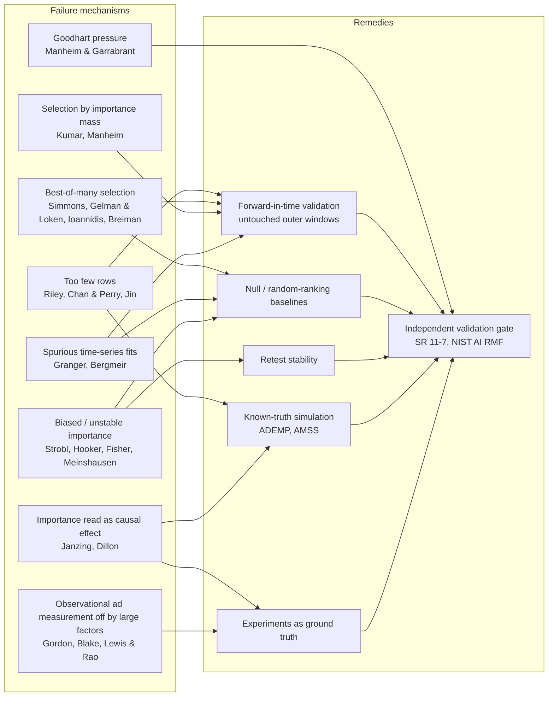

# Model Validation and Interpretability - Overview

> [!summary]
> This note brings together 25 sources on one practical question: **what has to be shown before a predictive-analytics
> product (a model that scores, ranks or attributes the drivers of a business outcome) is allowed to inform
> decisions?** The literature names eight ways such a product can look convincing and still be wrong. These are too few
> rows for too many candidate features, best-of-many selection, choosing fits by importance mass rather than held-out
> accuracy, chance correlation in autocorrelated weekly series, tree/SHAP importance that credits proxies and is
> unstable, reading importance as the effect of intervening, Goodhart pressure on the metric, and observational ad
> measurement that is plausible but off by large factors. It also names six remedies: forward-in-time validation with
> untouched outer windows, null and random-ranking baselines, retest stability, known-truth simulation (ADEMP, AMSS),
> experiments as ground truth, and an independent validation gate (SR 11-7, NIST AI RMF). A one-page checklist is in
> [[#Validation checklist]]. ^summary-mvi-overview

## Overview

The sources come from five literatures that seldom cite each other:

- **False discovery and overfitting**: [[Ioannidis 2005 - Why Most Published Findings Are False - Overview|Ioannidis 2005]], [[Simmons Nelson Simonsohn 2011 - False-Positive Psychology - Overview|Simmons et al. 2011]], [[Gelman Loken 2013 - Garden of Forking Paths - Overview|Gelman & Loken 2013]], [[Riley et al 2020 - Sample Size for Prediction Models - Overview|Riley et al. 2020]], [[Breiman 2001 - Statistical Modeling The Two Cultures - Overview|Breiman 2001]].
- **Feature importance and its stability**: [[Strobl et al 2007 - Bias in RF Variable Importance - Overview|Strobl et al. 2007]], [[Strobl et al 2008 - Conditional Variable Importance - Overview|Strobl et al. 2008]], [[Hooker Mentch Zhou 2021 - Permute-and-Predict Extrapolation - Overview|Hooker, Mentch & Zhou 2021]], [[Fisher Rudin Dominici 2019 - Model Class Reliance - Overview|Fisher, Rudin & Dominici 2019]], [[Meinshausen Buhlmann 2010 - Stability Selection - Overview|Meinshausen & Bühlmann 2010]].
- **Explanations, causality and proxies**: [[Kumar et al 2020 - Problems with Shapley-Value Explanations - Overview|Kumar et al. 2020]], [[Janzing et al 2020 - Feature Relevance as a Causal Problem - Overview|Janzing et al. 2020]], [[Dillon et al - SHAP and Causal Insights - Overview|Dillon et al.]], [[Manheim Garrabrant 2018 - Variants of Goodhart's Law - Overview|Manheim & Garrabrant 2018]].
- **Time series and marketing measurement**: [[Granger 2003 - Spurious Regression and Cointegration - Overview|Granger 2003]], [[Bergmeir Hyndman Koo 2018 - CV for Time Series - Overview|Bergmeir, Hyndman & Koo 2018]], [[Chan Perry 2017 - Challenges in Media Mix Modeling - Overview|Chan & Perry 2017]], [[Zhang Vaver 2017 - Aggregate Marketing System Simulator - Overview|Zhang & Vaver 2017]], [[Morris White Crowther 2019 - Simulation Studies (ADEMP) - Overview|Morris, White & Crowther 2019]], [[Bayesian Media Mix Modeling - Overview|Jin et al. 2017]], and the ad-experiment benchmarks [[Gordon et al 2019 - Facebook RCTs vs Observational Ad Measurement - Overview|Gordon et al. 2019]], [[Lewis Rao 2015 - Unfavorable Economics of Ad Measurement - Overview|Lewis & Rao 2015]] and [[Blake Nosko Tadelis 2015 - Paid Search Effectiveness - Overview|Blake, Nosko & Tadelis 2015]].
- **Model risk governance**: [[SR 11-7 - Model Risk Management Guidance - Overview|SR 11-7 (2011)]] and [[NIST AI RMF 1.0 - Overview|NIST AI RMF 1.0 (2023)]].

The common thread: **a model's fit, its plausibility to a domain expert, and how good its explanations look are not
evidence that it is right.** Evidence comes only from tests the model could have failed. Those tests are held-out
future data it never saw, a null baseline it had to beat, a re-run it had to agree with, a simulated world where the
truth is known, or an experiment.

## Main Content

### Part 1 — Eight failure mechanisms

#### 1. Too few rows for too many candidate features ^fail-rows

Weekly business data are short. Chan & Perry note that "three years of national weekly data is only 156 data points"
against 20+ media channels at 3-4 parameters each, while their rule of thumb is 7-10 points per parameter
([[Chan Perry 2017 - MMM Data Limitations (156 Rows, Correlated Channels, Narrow Spend Range)]]). Riley et al. make
the budget formal. For a target uniform shrinkage $S$ (they suggest $S \ge 0.9$) and anticipated Cox-Snell
$R^2_{CS}$, the minimum development sample for $p$ **candidate** parameters is

$$
n \;\ge\; \frac{p}{(S-1)\,\ln\!\left(1-R^2_{CS}/S\right)}
$$

([[Riley 2020 - Shrinkage and Optimism Criteria for Overfitting]]). The count is of every parameter *considered*,
including those dropped by selection ([[Riley 2020 - Beyond the 10 Events-per-Variable Rule]]). Jin et al.'s
known-truth simulation shows what happens below the budget. With two years of weekly data, posterior response
curves were underestimated by about 18-40%, and the bias came from the priors, not the data
([[Jin 2017 MMM - Sample Size vs Bias Study (Two vs Sixty Years)]]).

#### 2. Best-of-many selection ^fail-best-of-many

If $M$ candidate specifications, feature sets or hyperparameter settings are scored on the same data and the best is
reported, the reported score is optimistic by roughly the expected maximum of $M$ noise draws: about
$\sigma\sqrt{2\ln M}$ for independent Gaussian errors ([[Out-of-Sample Validation for Time-Series Models]],
[[Manheim Garrabrant - Regressional Goodhart and Tails Coming Apart]]). The same arithmetic drives Simmons et al.'s
finding that four common researcher degrees of freedom push the false-positive rate from 5% to about 61%
([[Simmons 2011 - Table 1 Simulations of Four Researcher Degrees of Freedom]]). It also drives Gelman & Loken's point
that one analysis, chosen *after* seeing the data, is enough without any deliberate fishing
([[Gelman Loken 2013 - Four Testing Procedures and the Data-Contingent Decision Variable]]). Ioannidis shows the
field-level result: the positive predictive value of a "significant" finding falls with low pre-study odds, low power and
bias ([[Ioannidis 2005 - PPV of Research Findings and the 2x2 Framework]]). Breiman's Rashomon effect is the
model-space version: many models fit about equally well and tell different stories
([[Breiman 2001 - Rashomon Effect and the Multiplicity of Good Models]]). Chan & Perry show five MMM specifications,
all with $R^2$ = 0.98-0.99, whose sales predictions differ by up to 50%
([[Chan Perry 2017 - Five Plausible MMMs (Model Selection and Model Uncertainty)]]).

#### 3. Choosing fits by importance mass instead of held-out accuracy ^fail-importance-mass

A tempting selection rule is to keep the model whose explanations look strongest or most plausible, for example the
one that puts the most SHAP or importance mass on the drivers the client cares about. Kumar et al. show that Shapley
values do not answer the questions such a rule implicitly asks
([[Kumar et al - Shapley Values in Normative Model Evaluation]]). Manheim & Garrabrant classify it as **regressional
Goodhart**: selecting on a noisy proxy (explanation mass) for the goal (predictive and causal validity) picks up the
noise ([[Manheim Garrabrant - Regressional Goodhart and Tails Coming Apart]]). The NIST profile in this vault lists it
as an explicit anti-pattern ([[NIST AI RMF - Applying the Framework to Marketing Analytics Models]]). Only held-out
predictive accuracy is a selection criterion the model could fail.

#### 4. Chance correlation in autocorrelated weekly series ^fail-spurious

Two independent random walks regressed on each other in levels give "significant" slopes most of the time, and the
problem gets *worse* with more data, not better
([[Granger 2003 - Spurious Regression from Yule to Granger-Newbold]],
[[Granger 2003 - Spurious Regression Monte Carlo in Python]]). Granger & Newbold's rule of thumb: be suspicious when
$R^2 > DW$. Validation can fail the same way. Shuffled K-fold cross-validation is valid only for purely autoregressive
models with uncorrelated errors (Bergmeir et al.'s Theorem 1). With exogenous trending drivers or carryover it leaks
the future into training and rewards the wrong model
([[Bergmeir 2018 - Theorem 1 Validity of K-Fold CV for Autoregressive Models]],
[[Out-of-Sample Validation for Time-Series Models]]).

#### 5. Tree and SHAP importance that credits proxies and is unstable ^fail-importance

- **Split-selection bias.** Gini importance, and permutation importance from bootstrap forests, favour continuous and
  many-category predictors even when they are pure noise
  ([[Strobl 2007 - Split-Selection Bias in CART Trees]], [[Strobl 2007 - Bootstrap-Induced Association]]).
- **Correlated predictors.** Marginal permutation importance credits a predictor that is only correlated with a true
  driver ([[Strobl 2008 - Marginal vs Conditional Importance and Spurious Correlation]],
  [[Strobl 2008 - Correlated Predictor Selection in Tree Ensembles]]).
- **Extrapolation.** Permute-and-predict evaluates the model off the data manifold, where flexible learners
  extrapolate arbitrarily ([[Permute-and-Predict Extrapolation in Variable Importance]]). Marginal/interventional SHAP
  inherits the same cost ([[Kumar et al - Conditional vs Interventional Shapley Catch-22]]).
- **Instability.** A Rashomon set of near-equally-good models can rely on a feature anywhere in a wide range
  ([[Rashomon Sets and Model Class Reliance - Definitions]]). CV-tuned Lasso selections change sharply under
  resampling: in Meinshausen & Bühlmann's Fig. 7 the CV-tuned Lasso picks 11-75 false variables, against about 0-4
  for stability selection ([[Stability Selection Simulation Study - Designs A-G and Results]]).

#### 6. Importance is not the effect of intervening ^fail-causal

Interventional SHAP is causal *for the model*: it says how the model's output responds when an input is set
([[Janzing 2020 - Inputs as Causes - Interventional Equals Marginal Expectation]]). It says nothing about how the
*world* responds ([[Janzing 2020 - Conclusions, Limitations and Model-vs-World Attribution]]). In Dillon et al.'s
known-truth subscriber simulation, ad spend ranks as the second most important feature while its true causal effect
is zero. Double ML recovers effects under observed confounding but is confidently wrong under unobserved confounding
([[Dillon et al - SHAP Plots vs True Causal Effects]],
[[Dillon et al - Unobserved Confounding and Quasi-Experimental Remedies]]). Fisher et al. give the conditions
(true regression function, ignorability, positivity) under which a permutation-importance measure maps to an
average treatment effect ([[Model Reliance, Causal Effects and Conditional Model Reliance]]).

#### 7. Goodhart pressure on the metric ^fail-goodhart

Once a score or ranking is used to allocate budgets or judge teams, it becomes a target. Manheim & Garrabrant separate
four mechanisms: regressional (selection on noise), extremal (optimizing into regions where the relationship breaks,
such as budget optimizers extrapolating saturation curves), causal (intervening on a proxy that is not a cause) and
adversarial (agents gaming the metric)
([[Manheim Garrabrant 2018 - Variants of Goodhart's Law - Overview]],
[[Manheim Garrabrant - Goodhart Variants in Marketing Measurement and Model Validation]]).

#### 8. Plausible observational ad measurement wrong by large factors ^fail-observational

The strongest evidence that plausibility is not validity comes from ad experiments run next to observational
estimators on the same campaigns.

- Gordon et al.: across 15 Facebook RCTs, observational lifts from matching, stratification and regression adjustment
  were off by a factor of three in half of the studies, across all methods, even with excellent covariate balance
  ([[Gordon et al 2019 - Observational Lift Estimates by Study and Method]],
  [[Gordon et al 2019 - Propensity Estimation, Bootstrap Inference and Balance Diagnostics]]).
- Blake et al.: eBay paid search had an experimental ROI of about **-63%**, against OLS-implied ROIs above **+1,600%**
  ([[Blake 2015 - OLS vs IV Spend Elasticities and the Endogeneity Gap]],
  [[Blake 2015 - ROI Derivation from Experimental Log-Sales Effects]]).
- Lewis & Rao: even the experiments are weak. A profitable campaign explains about $10^{-4}$ of sales variance, so a
  1% selection bias swamps it ([[Lewis Rao 2015 - Impact-to-SD Ratio Derivation and Calibrated Campaign]]).

### Part 2 — Six remedies

#### R1. Forward-in-time validation with untouched outer windows ^rem-forward

Use rolling-origin evaluation: fit on data up to $t$, score on $t+1,\dots,t+h$, then move the origin forward. All
selection (features, hyperparameters, specification) happens in **inner** windows. The **outer** windows are scored
once, after everything is frozen, so the reported score is free of best-of-$M$ optimism
([[Out-of-Sample Validation for Time-Series Models]], [[Forecast Evaluation and Backtesting]]). Leave gaps between
training and test blocks when there is carryover. SR 11-7 adds that back-testing must use periods outside development
and horizons matched to how the model is used ([[SR 11-7 - Outcomes Analysis and Back-Testing]]).

#### R2. Null and random-ranking baselines ^rem-null

Every claimed skill needs a baseline it must beat: the naive or seasonal-naive forecast, a model fitted on
*phantom* (permuted or simulated-noise) regressors, and, for driver rankings, a **random-ranking permutation null**
(how often would a random ordering of the candidates do as well?)
([[Out-of-Sample Validation for Time-Series Models]], [[Permutation Tests and Exact Inference]]). Stability
selection's PFER bound turns the same idea into a guarantee on expected false selections
([[Stability Selection PFER Bound (Theorem 1) and Its Proof]]).

#### R3. Retest stability ^rem-stability

Re-run the whole pipeline on subsamples (blocked, for time series), adjacent windows and alternative near-optimal fits,
and report how much the rankings move. Use selection frequencies
([[Stability Paths and the Stable-Variable Set]]), the model-class-reliance range across the Rashomon set
([[Model Class Reliance - Outer and Inner Finite-Sample Bounds]]), and conditional rather than marginal importance
([[Conditional Permutation Importance (Strobl 2008 Algorithm)]],
[[Hooker Mentch Zhou 2021 - Conditional and Relearning Importance Measures]]).

#### R4. Known-truth simulation (ADEMP, AMSS) ^rem-simulation

Simulate data where the right answer is known, run the full method many times, and score bias, coverage and ranking
accuracy with Monte Carlo standard errors. Plan it with ADEMP: Aims, Data-generating mechanisms, Estimands, Methods,
Performance measures ([[Morris et al 2019 - ADEMP Planning of Aims, DGMs, Estimands and Methods]],
[[Morris et al 2019 - Performance Measures and Monte Carlo Standard Errors]]). For marketing, the AMSS simulator
supplies a data-generating mechanism with counterfactual ROAS ground truth
([[AMSS Ground Truth - Counterfactual Scenarios and Simulated ROAS]]); its lagged-effects study shows the ROAS bias
from leaving carryover out of the model ([[AMSS MMM Evaluation - Simple Scenario and Lagged-Effects Study]]). See
[[Morris et al 2019 - Applying ADEMP to Marketing-Model Validation]] and [[Designing Simulated-Data Experiments]].

#### R5. Experiments as ground truth ^rem-experiments

Where decisions hinge on causal effects, calibrate or check the model against randomized evidence: user-level RCTs,
geo experiments, or switch-off tests ([[Experimental Benchmarks for Observational Ad Measurement]],
[[User-Level vs Geo-Level Experiments - When to Use Which]],
[[Blake 2015 - Non-Brand DMA Geo Experiment and DiD Estimates]]). Plan for their low power
([[The Unfavorable Economics of Ad Experiments - Power and Signal-to-Noise]]) and feed the results in as priors
([[Q - Using Experiment Results as Priors in a Bayesian MMM]]).

#### R6. Independent validation gate (SR 11-7, NIST AI RMF) ^rem-gate

SR 11-7 requires **effective challenge** by staff who are independent of development, competent, and able to stop the
model ([[SR 11-7 - Model Definition, Model Risk and Effective Challenge]],
[[SR 11-7 - Validation Independence, Validation Gate and Periodic Review]]). It covers conceptual soundness,
ongoing monitoring and outcomes analysis. NIST's MAP-MEASURE-MANAGE cycle adds construct validity of the target metric
and testing, evaluation, verification and validation (TEVV) of the metrics themselves
([[NIST AI RMF - MEASURE Function]], [[NIST AI RMF - MAP Function]]). The gate decides with pre-registered acceptance
criteria, the governance analogue of a pre-analysis plan
([[SR 11-7 - Applying Model Risk Management to Marketing Analytics]]).

### Validation checklist

| # | Question to answer before use | Failure it guards against | Evidence that counts | Key notes |
|---|---|---|---|---|
| 1 | Is $n$ large enough for the number of **candidate** parameters? | [[#^fail-rows\|Too few rows]] | Riley criteria met, or shrinkage/priors justified and checked by simulation | [[Riley 2020 - Four-Step Procedure, pmsampsize and Worked Examples]] |
| 2 | Was every selection step done inside inner windows, with outer windows scored once? | [[#^fail-best-of-many\|Best-of-many]] | Nested rolling-origin score reported next to the in-sample score | [[Out-of-Sample Validation for Time-Series Models]] |
| 3 | Was the final model chosen on held-out accuracy, not on how its explanations look? | [[#^fail-importance-mass\|Importance mass]] | A written selection rule fixed before fitting | [[Kumar et al - Shapley Values in Normative Model Evaluation]] |
| 4 | Do trending series and shuffled CV create chance fits? | [[#^fail-spurious\|Spurious correlation]] | Unit-root / cointegration checks; blocked or forward CV; beats naive forecast | [[Granger 2003 - Spurious Regression and Cointegration - Overview]] |
| 5 | Does the model beat a null / random-ranking baseline? | Mechanisms 2, 4, 5 | Permutation or phantom-regressor p-value; skill over naive | [[Out-of-Sample Validation for Time-Series Models]] |
| 6 | Are rankings stable on re-run, subsamples and near-optimal alternative fits? | [[#^fail-importance\|Unstable importance]] | Selection frequencies, rank correlation across retests, MCR ranges | [[Stability Paths and the Stable-Variable Set]] |
| 7 | Is importance conditional, and are correlated proxies handled? | [[#^fail-importance\|Proxy crediting]] | Conditional or relearned importance; grouped features | [[Strobl 2008 - Permutation Importance Null Hypotheses]] |
| 8 | Is any causal language backed by a design, not by SHAP? | [[#^fail-causal\|Importance ≠ effect]] | DAG plus identification argument, or experiment | [[Dillon et al - Summary, Limitations and Marketing Implications]] |
| 9 | Does the method recover known truth in simulation, with Monte Carlo SEs? | All | ADEMP protocol; bias, coverage, rank recovery | [[Morris et al 2019 - Applying ADEMP to Marketing-Model Validation]] |
| 10 | Do causal outputs agree with experiments where those exist? | [[#^fail-observational\|Observational error]] | Lift-test calibration; tracked gap between model and RCT | [[Experimental Benchmarks for Observational Ad Measurement]] |
| 11 | What happens when the score becomes a target? | [[#^fail-goodhart\|Goodhart]] | Monitoring for drift, gaming and out-of-support recommendations | [[Manheim Garrabrant - Goodhart Variants in Marketing Measurement and Model Validation]] |
| 12 | Has an independent validator signed off against pre-set criteria? | All | Validation report; documented effective challenge; monitoring plan | [[SR 11-7 - Validation Independence, Validation Gate and Periodic Review]] |

### Concept map



## Examples

> [!example] Vault illustration (not from any one source): spurious drivers plus best-of-many selection
> **Setup.** A weekly KPI and 50 candidate drivers are all **independent random walks**, so no driver has any real
> relationship to the KPI. Use 104 weeks for development and 26 later weeks as an untouched outer window. In each of
> 2,000 replications, regress the KPI on each candidate in levels, then pick the candidate with the best in-sample
> $R^2$.
>
> **Results** (simulation run 2026-10-13, seed 2026):
> - About **77%** of the 100,000 single-driver regressions have $|t| > 1.96$, against a nominal 5%. This matches
>   Granger & Newbold's "roughly three-quarters".
> - The *selected* driver has a median in-sample $R^2$ of **0.68**.
> - On the outer window, the naive "last value carried forward" forecast beats the selected driver model in
>   **72%** of replications (Monte Carlo SE about 1.0 point).
>
> **Reading.** In-sample fit and significance say nothing here. The forward window plus a naive baseline (R1 + R2)
> exposes the selected model at once.

```python
import numpy as np
rng = np.random.default_rng(2026)
R, n_tr, n_te, M = 2000, 104, 26, 50
naive_wins = 0
for _ in range(R):
    y = np.cumsum(rng.normal(size=n_tr + n_te))
    X = np.cumsum(rng.normal(size=(n_tr + n_te, M)), axis=0)
    best = None
    for j in range(M):
        A = np.c_[np.ones(n_tr), X[:n_tr, j]]
        b, *_ = np.linalg.lstsq(A, y[:n_tr], rcond=None)
        e = y[:n_tr] - A @ b
        r2 = 1 - e @ e / np.sum((y[:n_tr] - y[:n_tr].mean()) ** 2)
        if best is None or r2 > best[0]:
            best = (r2, j, b)
    _, j, b = best
    pred = b[0] + b[1] * X[n_tr:, j]
    naive_wins += np.mean((y[n_tr:] - y[n_tr - 1]) ** 2) < np.mean((y[n_tr:] - pred) ** 2)
print(naive_wins / R)   # about 0.72
```

> [!example] Applying the checklist to a driver-ranking product (generic)
> Suppose a vendor's tool fits a gradient-boosted model to 2-3 years of weekly KPI data with 60-100 candidate drivers,
> and ranks the drivers by mean |SHAP|. The checklist asks for:
> 1. Riley's bound for the candidate count, not the retained count.
> 2. A nested rolling-origin score against a seasonal-naive baseline.
> 3. A random-ranking permutation p-value for the top-$k$ drivers.
> 4. Rank stability across adjacent windows and re-seeds.
> 5. Conditional or grouped importance for correlated drivers.
> 6. An AMSS-style simulation in which the planted drivers must be recovered.
> 7. A comparison with any lift tests.
> 8. A validator's sign-off before the rankings reach budgeting.
>
> Any step the tool cannot pass is a reason to present its output as exploratory, not as evidence.

## Connections

- **Builds on** [[Garden of Forking Paths]], [[Researcher Degrees of Freedom]], [[Cross Validation Checking]],
  [[Model Selection and Overfitting]], [[Multiple Testing Corrections]], [[Type S and Type M Errors]].
- **Applies to** [[MMM Model Selection and Application]], [[Bayesian Media Mix Modeling - Overview]],
  [[Experimental Benchmarks for Observational Ad Measurement]], [[Single Marketing Time Series]].
- **Related causal-ML tools** [[Honest Trees and Causal Forests]], [[DML Estimators for ATE and the Interactive Model]],
  [[DAGs and Causal Identification]].
- **Related Bayesian checks** [[Simulation-Based Calibration - Overview]], [[Posterior Predictive Checking]].
- **Q&A** [[Q - Handling Multiple Comparisons When Selecting From Hundreds of Models]],
  [[Q - Sample Splitting and Pre-registration as Cures for Forking Paths]].

## See Also

- [[Model Validation and Interpretability/_Index|Model Validation and Interpretability]] — routing index for the six clusters
- [[Overfitting and False Discovery/_Index|Overfitting and False Discovery]] · [[Feature Importance and Stability/_Index|Feature Importance and Stability]] · [[Explanations, Causality and Proxies/_Index|Explanations, Causality and Proxies]] · [[Time Series Validation/_Index|Time Series Validation]] · [[Simulation-Based Method Validation/_Index|Simulation-Based Method Validation]] · [[Model Risk Governance/_Index|Model Risk Governance]]
- [[User-Level Ad Experiments/_Index|User-Level Ad Experiments]] · [[Bayesian Media Mix Modeling/_Index|Bayesian Media Mix Modeling]] · [[Research Methodology/_Index|Research Methodology]]
