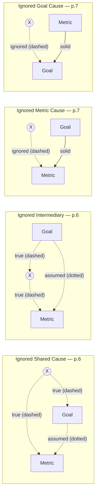

# Manheim Garrabrant - Non-Causal Goodhart Effects in Causal Systems

> [!summary]
> The paper separates *causal* Goodhart (the regulator intervenes) from cases where the regulator merely **misunderstands the causal structure but only selects**. These mistakes produce **worsened regressional** or **extremal** Goodhart, not causal Goodhart. There are three cases. **Ignored shared cause** (eq. 4): $M$ and $G$ are both noisy children of $X$, so they are conditionally independent given $X$, and selection that pins $X$ removes the proxy's validity (this resembles regime change). **Ignored intermediary**: an unmodelled mediator adds noise, which worsens regressional and extremal effects. **Ignored additional cause** (eq. 5-6): the metric (or goal) has other causes. Whether this acts as regressional, model-insufficiency or regime-change Goodhart depends on how the ignored cause $X$ is distributed.
^summary

## Overview

On p.6 the paper turns from the regulator's interventions to the regulator's *beliefs*: "the figures show where the regulator mistakes the form of the causal relationship. The dashed lines are the true causal path, and the dotted lines are the assumed ones. If the regulator attempts to select on the basis of the assumed model, it can lead to worsened regressional Goodhart effects or extremal Goodhart effects, but not causal Goodhart effects."

The general rule (p.6): causal mistakes plus intervention give causal Goodhart, and the same causal mistakes plus selection give regressional or extremal Goodhart.

## Main Content

### Figures (p.6 and p.7), reconstructed

Line conventions in the paper (p.6): "The dashed lines are the true causal path, and the dotted lines are the assumed ones." The edge labels below carry the same distinction, because mermaid draws dashed and dotted lines alike: **true (dashed)**, **assumed (dotted)**, and **solid** for edges the paper draws as plain solid lines. These edge styles were checked against a high-resolution render of the PDF.

Reading the panels edge by edge:
- **Ignored Shared Cause (p.6).** True edges: $X\to\text{Metric}$ and $X\to\text{Goal}$, both dashed. The assumed edge is a single **directed** dotted arrow, $\text{Goal}\cdots\!\!\to\text{Metric}$, with the arrowhead at Metric. It shows the regulator's belief that the relationship between Goal and Metric "is a causal chain, or is direct" (p.6), whereas Metric and Goal are in fact siblings. (The rendered PDF shows the arrowhead at Metric, not at Goal.)
- **Ignored Intermediary (p.6).** True path: $\text{Goal}\to X\to\text{Metric}$, dashed. Assumed: a direct dotted arrow $\text{Goal}\cdots\!\!\to\text{Metric}$.
- **Ignored Metric Cause / Ignored Goal Cause (p.7).** These panels have no dotted edge. The modelled relationship (Goal→Metric, or Metric→Goal) is drawn **solid**, and the overlooked extra cause $X$ enters through a **dashed** arrow, i.e. a true path the regulator ignores. The paper never defines what the solid lines mean. Our reading is "modelled and true", which fits the dashed=true convention.

> [!note] Source inconsistencies in the figure references (p.6-7)
> 1. The subsection opens with "In the below three cases, the figures show where the regulator mistakes the form of the causal relationship" (p.6), but the figure that follows has **only two panels** (Ignored Shared Cause, Ignored Intermediary). The third case is not in that figure.
> 2. The third case, Ignored Additional Cause, ends its definition with "(No Figure provided.)" (p.7), yet a two-panel figure labelled "Ignored Metric Cause" / "Ignored Goal Cause" is printed directly above that definition on p.7. These are the two variants of eq. (5) and eq. (6).
>
> Taken together, the third figure was probably added in a later revision (this is v4) without updating the surrounding text. Read "three cases" as covering both figures, and ignore "(No Figure provided.)".
^note-figure-inconsistency

> [!definition] Ignored Shared Cause (§3, p.6)
> "The regulator assumes the relationship between the Goal and Metric is a causal chain, or is direct, but there is instead a shared cause. When ignoring X, the metric is valid as a proxy for the goal."
>
> **Simple model, eq. (4):**
> $$
> \text{Metric}\sim \text{normal}(X,\sigma_m^2),\qquad \text{Goal}\sim\text{normal}(X,\sigma_g^2) \tag{4}
> $$
>
> "However, because of the conditional independence of Goal and Metric, for any fixed value of X they are uncorrelated. This means that our metric is less valid if there is selection. With selection of a fixed X, the case resembles extremal Goodhart, since the regime changed."
^def-ignored-shared-cause

*Vault gloss.* Marginally, $\operatorname{Corr}(M,G)=\operatorname{Var}(X)/\sqrt{(\operatorname{Var}X+\sigma_m^2)(\operatorname{Var}X+\sigma_g^2)}$. Selection that narrows the range of $X$ shrinks $\operatorname{Var}(X\mid\text{selected})$, and the correlation falls towards zero. Within a stratum of $X$ the proxy is useless. This is selection-induced attenuation (range restriction), not an intervention.

> [!definition] Ignored Intermediary (§3, p.7)
> "The regulator assumes the relationship between the Goal and Metric is direct, but an intermediary exists which creates an additional source of noise."
>
> "Without intervention, the causal mistake here adds a term to the error, leading to the earlier cases of regressional and extremal Goodhart effects."
^def-ignored-intermediary

> [!definition] Ignored Additional Cause (§3, p.7)
> "The metric is caused by multiple factors, of which the goal relates to only some. Alternatively, the goal is caused by multiple factors, of which the metric relates to only some."
>
> **Simple models, eq. (5) or (6):**
> $$
> \text{Metric}\sim\text{normal}(X+\text{Goal},\sigma_m^2)\tag{5}
> $$
> $$
> \text{Goal}\sim\text{normal}(X+\text{Metric},\sigma_g^2)\tag{6}
> $$
^def-ignored-additional-cause

> [!theorem] Classification of the ignored additional cause (§3, p.7)
> Which Goodhart effect an ignored cause $X$ produces depends on its distribution:
> 1. **$X$ matches the assumed error distribution** ("If X has a distribution that matches the distribution of error of the assumed relationship between X and the metric"): **worsened regressional Goodhart**, "because additional noise is due to X".
> 2. **$X$ is distributed differently from the assumed error**: "there is a model insufficiency issue", i.e. extremal Goodhart by model insufficiency.
> 3. **$X$ contains a nonlinearity**: "it is a regime change", i.e. extremal Goodhart by change in regime.
>
> "The earlier examples of extremal Goodhart effects are of these types. (More complex errors can lead to similar mistakes.)"
^thm-additional-cause-classification

Worked reading of the examples (p.7). In eq. (6) "the goal is caused by the metric, for example height causing windspeed". The paper adds: "More commonly, the metric would be caused by some $Y$, which also causes the Goal. In such a case, the metric might be measured height, where the measurement itself can have error." The wind-instrument saturation example from §2 is therefore an ignored additional cause (instrument tolerance) with a nonlinearity, which makes it a regime change.

## Examples

> [!example] Range restriction from an ignored shared cause (vault illustration)
> Market size $X$ drives both media spend (the metric used as a proxy for "where demand is") and sales (the goal) across regions. Across all regions, spend and sales are strongly correlated. An analyst who selects only large markets for a test, i.e. fixes $X$ near its top, finds almost no spend-sales correlation among them. This is not because media stopped working. Within a fixed $X$ the original correlation came entirely from $X$.
^ex-range-restriction-from-an

> [!example] Ignored metric cause in attribution
> Attributed conversions (the metric) depend on true incremental conversions (the goal) *and* on tracking coverage, consent rates and deduplication rules (the ignored additional cause $X$). If coverage varies like noise, ranking campaigns by attributed conversions suffers worse regressional Goodhart. If coverage changes abruptly, for example after a consent-policy change, the ranking crosses a regime boundary, and the post-change metric is related to the goal by a different function.
^ex-ignored-metric-cause-in

## Connections

- **Confounding and range restriction**: [[Omitted Variables Bias]], [[Conditional Independence Assumption]], [[Markov and Faithfulness Assumptions]].
- **Proxy features in explanations.** Conditional SHAP credits proxies that share causes with the true driver: [[Kumar et al 2020 - Problems with Shapley-Value Explanations - Overview]], [[Strobl et al 2008 - Conditional Variable Importance - Overview]].
- **Spurious association from shared trends** is an ignored shared cause in time series: [[Granger 2003 - Spurious Regression and Cointegration - Overview]].

## See Also
- [[Manheim Garrabrant - Causal Goodhart via Shared Cause, Intermediary and Metric Manipulation]] — the interventional counterparts
- [[Manheim Garrabrant - Adversarial Goodhart, Campbell's Law and Cobra Effects]] — the normal cobra effect exploits an ignored additional cause $Y$
- [[Manheim Garrabrant 2018 - Variants of Goodhart's Law - Overview]]
